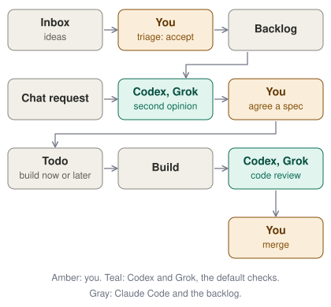
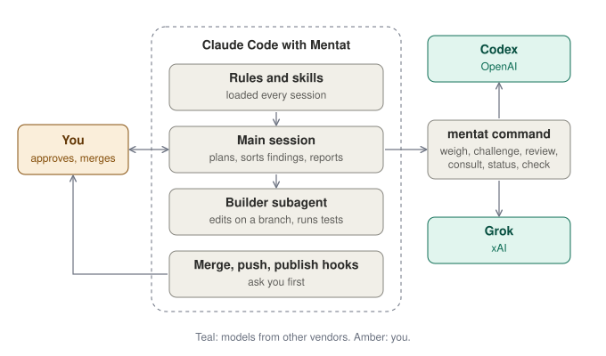

<p align="center">
  <picture>
    <source media="(prefers-color-scheme: dark)" srcset="docs/images/mentat-mark-dark.svg">
    
  </picture>
</p>

<h1 align="center">Mentat</h1>

<p align="center"><a href="https://github.com/ericfurspan/mentat/actions/workflows/tests.yml"></a></p>

Mentat is a Claude Code plugin for building software with multiple AI agents.

Claude Code plans and builds each change, Codex and Grok give second opinions and review the code, and you decide what gets built and merge every pull request. Hooks ask you before risky commands, such as a merge or a push to the default branch.

<p align="center">
  
</p>

<p align="center">
  
</p>

## Requirements

- macOS, with Claude Code, `git`, `jq`, and `gh` signed in.
- For reviews: the Codex CLI, signed in and installed under `/opt/homebrew` or `/usr/local`. Weigh, challenge and consult need it only when it is in effect (see Review tools).
- Optional: Grok Build (`grok`), signed in with `grok login`, for a second review.
- Optional: `gitleaks`, to catch likely secrets before a commit.

## Install

In each repository:

```bash
claude plugin install mentat --marketplace ericfurspan/mentat --scope project
```

This writes the repository's `.claude/settings.json`, so Mentat is on for everyone using Claude Code there. Use `--scope local` for only you, or `--scope user` for every folder.

- Update: `claude plugin marketplace update mentat`, then `claude plugin update mentat@mentat --scope <install scope>`.
- Remove: `claude plugin uninstall mentat@mentat --scope <install scope>`.

Where a repository requires an approval, the agent needs its own GitHub account.

## Usage

Ask for a change in chat and Mentat runs the workflow. These commands do the rest:

- `/mentat:agenda [project ... | all]`: what waits on you, and the one thing to do next.
- `/mentat:intake [project ... | all] | brainstorm <text or link>`: gather ideas and settle each with you.
- `/mentat:plan [item id]`: plan one backlog item, or the whole backlog, without building.
- `/mentat:work-tickets [item id ...]`: build agreed backlog items in a row, one pull request each.
- `/mentat:zoom-out`: a short summary of the goal, progress and next step.
- `/mentat:retro`: review a session and propose improvements.
- `/mentat:setup [first-run]`: show and change settings; start with `first-run`.
- `/mentat:linear [project name] [team name]`: move the repository's planning from GitHub issues to Linear.
- `/mentat:consult [--web] <question or idea>`: ask Codex, Grok and Claude Code one question.
- `/mentat:claude-review`: turn Codex and Grok off; Claude reviews instead.

[`rules.md`](rules.md) has the full workflow.

## Review tools

Weigh and consult run Codex and Grok unless `~/.config/mentat/reviewers` lists tools, any of `claude`, `codex` and `grok`; then they run the listed ones. Challenge runs Codex unless that file lists tools without `codex`; then it runs Claude. In weigh and challenge, Claude has read-only file tools and no shell or web; in consult, it has web search only. Claude runs headless on the most capable Claude model in a family other than the builder's, or on the model named in `~/.config/mentat/claude-model`. `/mentat:setup` shows and changes both files, and `mentat check` reports each tool in effect.

## Credits

Third-party credits and licenses are in the `CREDITS.md` files under `skills/`.
