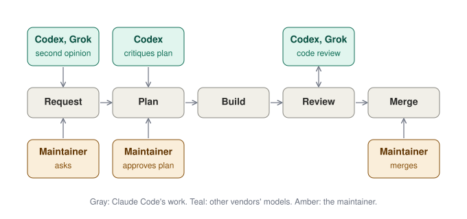

<p align="center">
  <picture>
    <source media="(prefers-color-scheme: dark)" srcset="docs/images/mentat-mark-dark.svg">
    
  </picture>
</p>

<h1 align="center">Mentat</h1>

<p align="center"><a href="https://github.com/ericfurspan/mentat/actions/workflows/tests.yml"></a></p>

Mentat is a Claude Code plugin that runs a multi-agent coding workflow for one maintainer of a GitHub repository. Claude Code proposes a plan, with Codex and Grok weighing in on new ideas and Codex challenging an uncertain plan, and a builder makes the change once the maintainer agrees. Codex reviews the pull request after every fix, Grok adds a second review where it is installed, and the maintainer merges. Along the way, the maintainer can step back with `/mentat:zoom-out`, put one question to several models with `/mentat:consult`, and review a session for improvements with `/mentat:retro`.

<p align="center">
  
</p>

## How a change moves

1. A request in chat or a backlog item. Claude Code reads the code and gives its view; for a new feature or a workflow change, Codex and Grok weigh it too (`mentat weigh`). The maintainer agrees on what gets built.
2. A builder subagent makes the change, or a batch of changes the maintainer agreed to, on its own branch and runs the test command; the chat shows plans and reports, not diffs.
3. Claude Code opens a pull request; its description opens with a `## Summary` heading, then a status line, a `Why:` line saying where the work came from, and a note of at most two sentences: what the change does, then the one thing to read before merging, when there is one. `mentat review` waits for CI, then Codex reviews the head commit, and Grok the first one. If Grok cannot run, for example because it is not signed in, Codex carries on and the description says why; nothing stops for it. Findings with a realistic trigger are fixed, the rest answered with a reason, for at most five rounds. A typo-level change can skip both reviews if the maintainer agrees to a fast track.
4. Claude Code checks the diff against the description and the spec, marks the status line Ready and reports it as "You: merge #N." with at most one more sentence; a hand check still open blocks it instead, with its steps at the top of the backlog item or pull request and one sentence in chat. Chat names work in plain words and puts links on a message's last line, so the pull request's link ends the report.
5. The maintainer merges. Hooks ask before any merge or push to the default branch.

The agreed text has the shape of a spec, and each requirement is traced to its evidence; [spec-driven development](docs/spec-driven.md) maps the steps to that practice.

[How it works](docs/how-it-works.md) has the full flow.

Mentat is built with Mentat. Every pull request here is opened by the agent account `ericfurspan-agent` under this workflow and merged by the maintainer; that account cannot approve its own pull requests. The [merged pull requests](https://github.com/ericfurspan/mentat/pulls?q=is%3Apr+is%3Amerged) show the flow as it ran.

## Requirements

- macOS, Claude Code, `git`, `jq`, and `gh` signed in.
- For reviews: the Codex CLI signed in.
- Optional: Grok Build (`grok`), for a second review and a second view in `mentat weigh`.

## Install

```bash
claude plugin install mentat --marketplace ericfurspan/mentat
```

[Setup](docs/setup.md) has the plugin commands and the review setup.

## Commands

The `mentat` command (`review`, `status`, `challenge`, `weigh`, `consult`, `check`) runs from Claude Code's shell; [How it works](docs/how-it-works.md) lists each with its exit codes. Outside the workflow, `weigh`, `challenge` and `review` run in a git checkout, and `review` needs a GitHub pull request and posts one review (the review loop is the plugin's, not the command's); `consult` runs in any folder.

- `/mentat:zoom-out`: a one-time summary of the goal, progress, open questions and the next step. Changes nothing.
- `/mentat:come-again`: restates the last reply in three short lines or fewer.
- `/mentat:grill`: interviews you about a plan, decision or idea, one clickable question at a time, each built on your last answer, and ends with a list of what was agreed. Claude Code may offer a grill; it starts one only if you agree.
- `/mentat:retro`: reviews a session and proposes improvements one at a time, with evidence. Agreed ones are filed in the backlog.
- `/mentat:setup`: shows the repository's Mentat settings (the backlog, the test command, the Code Review Rules) and changes the ones you pick, in AGENTS.md. It can also move planning from GitHub issues to a Linear project.
- `/mentat:consult <question>`: consults Codex, Grok and Claude Code on any question, with the web, and answers in five short lines at most: the consensus first, then what each model adds. Runs anywhere, no repository needed.
- `/mentat:claude-review`: turns Codex and Grok off for the session. One Claude code review replaces the review loop, and plans are not challenged or ideas weighed, until you say in chat to turn Codex back on.

## Docs and credits

- [How it works](docs/how-it-works.md): the full flow, the hooks, the commands.
- [Spec-driven development](docs/spec-driven.md): where Mentat's steps fall in that practice.
- [Setup](docs/setup.md): what a machine needs, the plugin commands, the review setup.
- Third-party credits and licenses: the `CREDITS.md` files under `skills/`.
