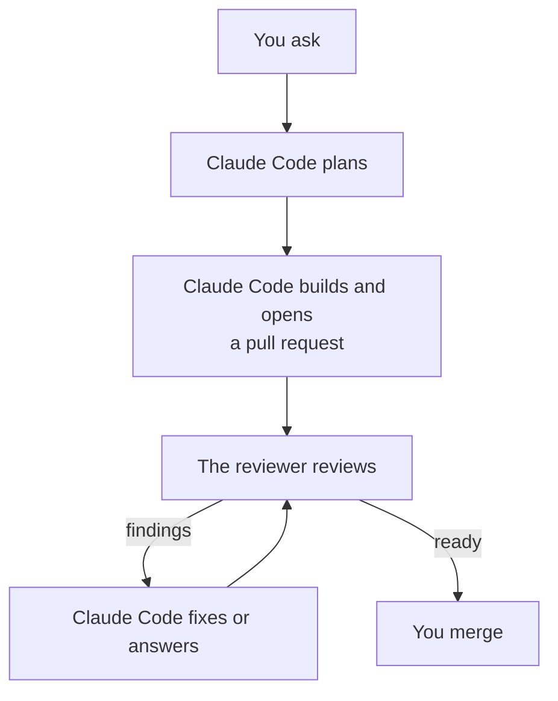

# How Mentat works

*For people. Agents follow `rules.md` and the skills in `skills/`, not this page.*

## A change, in full

1. Work starts from a chat request or an issue. Claude Code reads the repository's AGENTS.md files and the code, then gives you its view of the request. For a new feature or a change in the workflow, Codex and Grok also weigh the idea (`mentat weigh`), and their verdicts come beside its own. Once you agree, it writes down what it will build, what it will leave alone and how the result will be checked. An uncertain or consequential plan gets a challenge from the reviewer first ([`skills/plan`](../skills/plan/SKILL.md)). When a request leaves decisions open that only you can make, it offers `/grilling`; when a plan deserves a skeptic, `/the-fool`.
2. One builder, one branch, one checkout per change. The builder is a subagent, so its edits stay out of the chat: the main session plans, briefs and reports. Claude Code never edits files in the main session. The repository's test command runs before the pull request opens and after every fix; a bug fix starts with a check that fails on the bug.
3. Every pull request opens as a normal pull request, not a draft, with a description that gives a short summary, before-and-after evidence and the merge danger ([`skills/pr`](../skills/pr/SKILL.md)).
4. `mentat review` waits for CI on the head, then comments `@codex review` on the pull request, which starts the Codex app's review of that commit; or `mentat review --local` reviews it with local Codex. Claude Code fixes findings that have a realistic trigger, answers the rest with a reason, and reviews again. A real defect is never left to a follow-up issue on its own; five rounds is a hard stop. When the loop ends ready, Claude Code posts a final check (its own check, not a review or an approval) and reports that the pull request is ready. If the loop is blocked, not reviewed, or reaches five rounds without being ready, it reports why and stops ([`skills/review`](../skills/review/SKILL.md)).
5. You merge, the way the repository merges.

With the reviewer off for a session (`/mentat:codex-review-off`), one Claude `code-review` at medium effort replaces the review loop, at most two rounds, with no plan challenges and no `mentat weigh`. Claude Code still runs the tests, waits for CI with `mentat ci`, and posts the final check marked reviewed by Claude; if `code-review` cannot run, the final check says "Not reviewed" and why. The Codex app, if its automatic review is on, may still review when the pull request opens; that is the app's setting.

## The repository comes first

Where a repository's AGENTS.md differs from `rules.md` on a preference (commit and title format, branch flow, labels, templates, or a workflow that commits to the default branch), the repository wins and Claude Code says so once. That covers only what the repository names; it never allows pushing code changes to the default branch, and the rules on approval and on what agents never do always hold.

## What holds, and how

- The SessionStart hook puts `rules.md` into every session's context, on startup, resume, clear, compact and fork.
- The merge hook asks you in a permission prompt before any `gh pr merge` command (including `--auto`), any call to the pull request merge API through `gh api`, and the desktop app's auto-merge tool. Claude Code's docs say a hook's "ask" still prompts in auto mode; behavior in bypass-permissions mode is not documented. It is a net for mistakes, not a security boundary: other routes to a merge exist.
- The push hook asks you in a permission prompt before a `git push` that would change the default branch: a refspec ending there, a delete of it, `--all`, `--mirror`, or a push with no refspec while the default branch is checked out. It reads the default branch from `origin/HEAD` and falls back to `main` and `master`. It too is a net for mistakes, not a security boundary: other routes to a push exist, such as the GitHub API.
- `rules.md` asks agents never to merge, release, deploy, publish, change secrets or run production operations; never to commit secrets; never to push code changes to the default branch or change repository settings; and to keep production credentials out of agent sessions. These are instructions. An agent that ignores them can still do what its GitHub access and your Mac allow; Mentat does not sandbox it, and Claude Code's permission modes are the local control. Rulesets and required approvals on a repository are that repository's own choice, not part of Mentat.
- Local Codex (`review --local`, `challenge` and `weigh`) runs under a permissions profile that lets it read only the checkout, its git directory and the system and tool paths, with no writes and no network for the commands it runs. Inside the checkout, files that commonly hold credentials (`.env` files, private keys such as `*.pem` and `id_ed25519`, `.netrc`, `.npmrc`, `.pypirc`) are denied to it as well; a credential committed to the repository stays readable through git history and must be rotated. Only core environment variables reach the commands it runs. Codex itself still talks to OpenAI, and its web search runs on OpenAI's side: local reviews turn search off, and `mentat challenge` and `mentat weigh` keep Codex's cached search to check current practice. `tests/review-local.sh` replays the profile through the real `codex sandbox` on macOS.

## Commands

| Command | What it does | Exit codes |
|---|---|---|
| `mentat review <PR>` | Waits for CI on the pull request's head (up to 30 minutes; with no CI, about a minute), then comments `@codex review` on the pull request, which starts the Codex app's review of that head, and waits up to 20 minutes for the result. Each round posts a new comment. With no result in time, Claude Code falls back to `--local` | 0 no findings, 2 findings posted (links printed), 1 not reviewed, 3 head moved, 4 CI did not pass (failing or unfinished checks printed) |
| `mentat review --local <PR>` | Waits for CI the same way, then reviews the pull request's head with local Codex in a temporary checkout, and posts the result on the pull request if the head has not moved | same |
| `mentat review --grok <PR>` | Waits for CI the same way, then reviews the pull request's head with Grok (if installed) and posts the result. A start comment goes up first, and the command refuses to run again when one from its own GitHub account is already there, so Grok runs once per pull request. Grok gets read-only file tools and no shell, a plain export of the head without `.git`, and the diff in its prompt. It runs on your Grok sign-in in a fresh home with only a copy of `auth.json`, inside Grok's own sandbox, which denies it the temporary folders, `~/Library`, your own Grok home and the usual credential files, and refuses to start if it cannot apply. Grok has its own time limit, `MENTAT_GROK_TIMEOUT_SECONDS` (default 1800); a run that fails leaves a private log, with Grok's debug record, that is never printed | same |
| `mentat ci <PR>` | Waits for CI on the pull request's head the same way, and reviews nothing. Used when the reviewer is off | 0 CI passed or there is none, 1 could not read, 3 head moved, 4 CI did not pass |
| `mentat challenge <plan-file>` | Codex challenges a written plan against the repository and ends with a verdict | 0 delivered (read the verdict), 1 not challenged |
| `mentat weigh <idea-file>` | Codex and Grok each judge an idea, in parallel and apart from Claude Code's view, as of `HEAD` (uncommitted changes are not weighed, and the output says so): worth doing, a simpler way, the risks. Printed, never posted. Codex reads a detached worktree; Grok runs confined as in `review --grok`, on an export of the same commit. Each ends with a verdict line (`DO IT`, `DO IT DIFFERENTLY - <how>` or `DON'T - <why>`), or a "not weighed" line with the reason. Time limits: `MENTAT_REVIEW_TIMEOUT_SECONDS` (Codex) and `MENTAT_GROK_TIMEOUT_SECONDS` | 0 at least one verdict, 1 none, 64 usage |
| `mentat check` | Checks, read-only, what Mentat itself needs: `git`, `gh` and `jq` installed, `gh` signed in, the repository readable. Prints the installed `codex` version and warns when `codex` is missing, and prints the `grok` version when installed (Grok is optional) | 0 Mentat can work, 1 it cannot |

## What it does not do

- Linux, Windows, other Git hosts, organizations and team workflows.
- Running deployments or infrastructure.
- Changing a repository's GitHub settings. `mentat check` reads none of them.

## Developing Mentat

`tests/run` is the one test command; it runs locally on macOS, and this repository has no CI. Every change goes through the flow above, and the maintainer merges it. After a merge, the checkout updates its own plugin install, as `AGENTS.md` says.
