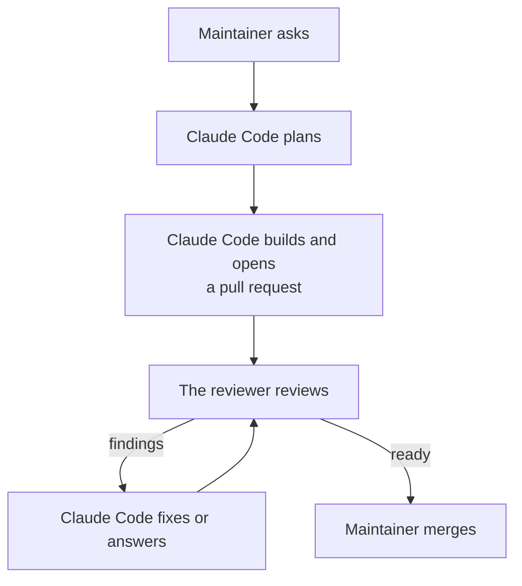

# How Mentat works

*For people. Agents follow `rules.md` and the skills in `skills/`, not this page.*

## A change, in full

1. Work starts from a chat request or an issue. Claude Code reads the repository's AGENTS.md files and the code, then gives the maintainer its view of the request. For a new feature or a change in the workflow, Codex and Grok also weigh the idea (`mentat weigh`), and their verdicts come beside its own. Once the maintainer agrees, it writes down what it will build, what it will leave alone and how the result will be checked. An uncertain or consequential plan gets a challenge from the reviewer first ([`skills/plan`](../skills/plan/SKILL.md)). When a request leaves decisions open that only the maintainer can make, it offers `/grilling`.
2. One builder, one branch, one checkout per change. The builder is a subagent; Claude Code plans, briefs and reports, and never edits files in the main session. The repository's test command runs before the pull request opens and after every fix; a bug fix starts with a check that fails on the bug.
3. Every pull request opens as a normal pull request, not a draft, with a description that gives a short summary, before-and-after evidence and the merge danger ([`skills/pr`](../skills/pr/SKILL.md)).
4. `mentat review` waits for CI on the head, then comments `@codex review` on the pull request, which starts the Codex app's review of that commit; or `mentat review --local` reviews it with local Codex. Claude Code fixes findings that have a realistic trigger, answers the rest with a reason, and reviews again. Five rounds is the limit. When the loop ends ready, Claude Code posts a final check (its own check, not a review or an approval) and reports that the pull request is ready. If the loop is blocked, not reviewed, or reaches five rounds without being ready, it reports why and stops ([`skills/review`](../skills/review/SKILL.md)).
5. The maintainer merges, the way the repository merges.

With the reviewer off for a session (`/mentat:codex-review-off`), one Claude `code-review` at medium effort replaces the review loop, at most two rounds, with no plan challenges and no `mentat weigh`. Claude Code still runs the tests, waits for CI with `mentat ci`, and posts the final check marked reviewed by Claude; if `code-review` cannot run, the final check says "Not reviewed" and why.

## The repository comes first

Where a repository's AGENTS.md differs from `rules.md` on a preference (commit and title format, branch flow, labels, templates), the repository wins and Claude Code says so once. The rules on approval and on what agents never do always hold.

## What holds, and how

- The SessionStart hook puts `rules.md` into every session's context, on startup, resume, clear, compact and fork, including how decisions and steps reach the maintainer.
- The merge hook asks the maintainer before any `gh pr merge` command (including `--auto`), any call to the pull request merge API through `gh api`, and the desktop app's auto-merge tool.
- The push hook asks the maintainer before a `git push` that would change the default branch (read from `origin/HEAD`, else `main` and `master`): a refspec ending there, a delete of it, `--all`, `--mirror`, or a push with no refspec while it is checked out.
- `rules.md` tells agents never to merge, release, deploy, publish, change secrets, run production operations, commit secrets, push code changes to the default branch or change repository settings.
- Local Codex (`review --local`, `challenge` and `weigh`) runs under a read-only permissions profile on the checkout, with credential files (`.env`, private keys, `.netrc`, `.npmrc`, `.pypirc`) denied and no network for the commands it runs. Web search is off for reviews and cached for `challenge` and `weigh`.

The hooks catch mistakes; they are not a sandbox, and Claude Code's permission modes remain the local control.

## Commands

| Command | What it does | Exit codes |
|---|---|---|
| `mentat review <PR>` | Waits for CI on the pull request's head (up to 30 minutes; with no CI, about a minute), comments `@codex review` to start the Codex app's review of that head, and waits up to 20 minutes for the result. Each round posts a new comment. With no result in time, Claude Code falls back to `--local` | 0 no findings, 2 findings posted (links printed), 1 not reviewed, 3 head moved, 4 CI did not pass (failing or unfinished checks printed) |
| `mentat review --local <PR>` | Waits for CI the same way, reviews the head with local Codex in a temporary checkout, and posts the result if the head has not moved. A reply ending `REVIEW RESULT: INCOMPLETE - <reason>` is posted and counts as not reviewed (exit 1) | same |
| `mentat review --grok <PR>` | Waits for CI the same way, reviews the head with Grok (if installed) and posts the result; an `INCOMPLETE` reply counts as not reviewed (exit 1). Posts a start comment first and refuses to run again when one from its own GitHub account is there, so Grok runs once per pull request. Grok runs in its own sandbox with file tools, no shell, on an export of the head without `.git`. Time limit: `MENTAT_GROK_TIMEOUT_SECONDS` (default 1800). A failed run leaves a private log that is never printed | same |
| `mentat ci <PR>` | Waits for CI on the head the same way and reviews nothing. Used when the reviewer is off | 0 CI passed or there is none, 1 could not read, 3 head moved, 4 CI did not pass |
| `mentat challenge <plan-file>` | Codex challenges a written plan against the repository and ends with a verdict | 0 delivered (read the verdict), 1 not challenged |
| `mentat weigh <idea-file>` | Codex and Grok each judge an idea as of `HEAD` (uncommitted changes are not weighed, and the output says so), in parallel: worth doing, a simpler way, the risks. Printed, never posted. Each ends with a verdict line (`DO IT`, `DO IT DIFFERENTLY - <how>` or `DON'T - <why>`) or a "not weighed" line with the reason. Time limits: `MENTAT_REVIEW_TIMEOUT_SECONDS` (Codex) and `MENTAT_GROK_TIMEOUT_SECONDS` | 0 at least one verdict, 1 none (stderr tells Claude Code to give its view alone and say the weighing did not happen), 64 usage |
| `mentat check` | Checks, read-only, that `git`, `gh` and `jq` are installed, `gh` is signed in and the repository is readable. Prints the `codex` version and warns when it is missing; prints the `grok` version when installed | 0 Mentat can work, 1 it cannot |

## What it does not do

- Linux, Windows, other Git hosts, organizations and team workflows.
- Running deployments or infrastructure.
- Changing a repository's GitHub settings. `mentat check` reads none of them.

## Developing Mentat

`tests/run` is the one test command; it runs locally on macOS, and on GitHub Actions (macOS) for every pull request. Every change goes through the flow above, and the maintainer merges it.
