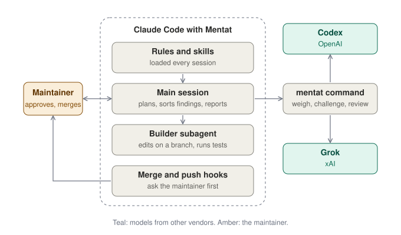

# How Mentat works

*For people. Agents follow `rules.md` and the skills in `skills/`, not this page.*

## What Mentat is made of

## A change, in full

1. Work starts from a chat request or a backlog item. Claude Code reads the repository's AGENTS.md files and the code, then gives the maintainer its view of the request. For a new feature or a change in the workflow, it first asks the maintainer, one at a time with its recommendation, only the decisions they can make now, and decides or defers the rest. Codex and Grok then weigh the idea with those answers (`mentat weigh`), and each verdict comes in one line beside its own. Its proposal says, in the maintainer's terms, what changes for them, what it adds to or drops from the request and how the result will be checked. Once the maintainer agrees, it writes the build detail in the spec: what it will build and what it will leave alone. An uncertain or consequential plan is then written out, and Codex challenges it before the build (`mentat challenge`, [`skills/plan`](../skills/plan/SKILL.md)).
2. One builder, one branch, one checkout per pull request. Several changes share one pull request only when the maintainer agreed to batch them, with one spec whose numbered requirements cover each change. The builder is a subagent; Claude Code plans, briefs and reports, and never edits files in the main session. The repository's test command runs before the pull request opens and after every fix; a bug fix starts with a check that fails on the bug.
3. Every pull request opens as a normal pull request, not a draft, with a description that opens with a status line (the state, the head commit, the tests and CI) and a short note to the maintainer: the change's intent, whether a revert undoes it, anything left unfixed and where to look first. Before-and-after evidence and the merge danger follow ([`skills/pr`](../skills/pr/SKILL.md)). Claude Code rewrites the status line and note at every update of the description.
4. `mentat review` waits for CI on the head, then reviews it with local Codex. Where `grok` is installed, Grok also reviews the first head, once per pull request, beside Codex's first round (`mentat review --grok`); its findings are sorted with Codex's. Claude Code fixes findings that have a realistic trigger, answers the rest with a reason, and reviews again. Five rounds is the limit. For a change that cannot alter what code does or what an agent is told (typos, broken links, formatting), the maintainer can agree to a fast track that skips the Codex and Grok reviews; tests, CI and the final check still run, and the status line reads `Not reviewed: fast track agreed by the maintainer`. When the loop ends ready, Claude Code does a final check (its own check, not a review or an approval): it reads the diff, the description and the spec again, marks the status line Ready and reports that the pull request is ready. If the loop is blocked, not reviewed, or reaches five rounds without being ready, it says why in the status line and note, reports it and stops ([`skills/review`](../skills/review/SKILL.md)).
5. The maintainer merges, the way the repository merges.

With Codex off for a session (`/mentat:codex-review-off`; Grok's review stops with it), one Claude `code-review` at medium effort replaces the review loop, at most two rounds, with no plan challenges and no `mentat weigh`. Claude Code still runs the tests, waits for CI with `mentat ci`, and does the final check, with the note saying the pull request was reviewed by Claude; if `code-review` cannot run, the status line says "Not reviewed" and why.

The backlog is GitHub issues, unless the repository's AGENTS.md names an external backlog. Then its item is the only record of a change: the idea, the order of agreed work, the plan, the evidence and a "Spec" section (older items say "Agreed request") written to be safe in public: one sentence of intent, numbered requirements that can each be checked, and what is out of scope. The pull request cites each requirement by number in its Evidence. [Spec-driven development](spec-driven.md) maps these steps to that practice. No issue is opened on GitHub, which holds pull requests only. Claude Code copies that section unchanged into a temporary file and passes it with `--request`, so Codex and Grok judge the change against it, apart from the pull request description, without access to the backlog ([`skills/backlog`](../skills/backlog/SKILL.md), [`skills/review`](../skills/review/SKILL.md)). The backlog skill also holds the GitHub-issues rules (the pinned issue's order of agreed work, type labels and stage labels), and supports Linear today as an external backlog, through Claude Code's Linear connector; another tracker means replacing that skill's tracker part and the AGENTS.md line.

## Who does what

The reference the other pages match.

| What | Who | When | How |
|---|---|---|---|
| Gives a view of a request | Claude Code | every request | chat |
| Requests a change, decides what gets built and agrees on the plan | the maintainer | every change | chat or an issue |
| Weighs an idea | Codex and Grok, in parallel | a new feature or workflow change, before the maintainer agrees | `mentat weigh` |
| Challenges a plan | Codex | an uncertain or consequential plan, after agreement and before the build | `mentat challenge`, through `skills/plan` |
| Builds and runs the test command | the builder subagent | every change and every review fix | one branch, one checkout |
| Runs the test command again, on a clean tree | Claude Code | before every push | the repository's test command |
| Pushes, opens and describes the pull request | Claude Code | every change | `git push`, `gh pr create`; the body from `skills/pr` |
| Reviews each head | Codex | every head, up to five rounds | `mentat review` |
| Reviews the first head | Grok, where installed | once per pull request, beside Codex's first round | `mentat review --grok` |
| Sorts findings and briefs the fixes | Claude Code | every round | `skills/review`, the builder subagent |
| Reviews when Codex is off | Claude (`code-review`) | after `/mentat:codex-review-off`, at most two rounds, once `mentat ci` passes | `skills/codex-review-off` |
| Does the final check | Claude Code | when the loop ends ready | reads the diff, the description and the spec; rewrites the status line |
| Merges | the maintainer | every pull request | |

Outside the table, `/mentat:consult <question>` (the maintainer starts it) asks Codex, Grok and Claude Code one question and answers in five short lines at most, the consensus first, then what each model adds; it is no step in a change. Weigh judges a change to this repository's code at HEAD; consult answers any question, no repository, web on.

## The repository comes first

Where a repository's AGENTS.md differs from `rules.md` on a preference (commit and title format, branch flow, labels, templates), the repository wins and Claude Code says so once. The rules on approval and on what agents never do always hold.

## What holds, and how

- The SessionStart hook puts `rules.md` into every session's context, on startup, resume, clear, compact and fork, including how decisions and steps reach the maintainer.
- The merge hook asks the maintainer before any `gh pr merge` command (including `--auto`), any call to the pull request merge API through `gh api`, and the desktop app's auto-merge tool.
- The push hook asks the maintainer before a `git push` that would change the default branch (read from `origin/HEAD`, else `main` and `master`): a refspec ending there, a delete of it, `--all`, `--mirror`, or a push with no refspec while it is checked out.
- `rules.md` tells agents never to merge, release, deploy, publish, change secrets, run production operations, commit secrets, push code changes to the default branch or change repository settings.
- Local Codex (`review`, `challenge` and `weigh`) runs under a read-only permissions profile on the checkout, with credential files (`.env`, private keys, `.netrc`, `.npmrc`, `.pypirc`) denied and no network for the commands it runs. Web search is off for both reviewers. In `challenge` and `weigh`, Codex's search is cached (OpenAI's index, no live fetches); in `weigh`, Grok may use its backend web search (on xAI's side, nothing fetched from this machine; the local fetch tool is denied) and says which claims it checked. `consult` runs both tools with no files or repository at all and with web search on (Codex live, Grok backend; the local fetch tool stays denied). Codex's own global instruction file, when the user has one, loads in every Mentat Codex run, consult included.

The hooks catch mistakes; they are not a sandbox, and Claude Code's permission modes remain the local control.

## Commands

| Command | What it does | Exit codes |
|---|---|---|
| `mentat review [--local] [--request <file>] <PR>` | Waits for CI on the pull request's head (up to 30 minutes; with no CI, about a minute), reviews the head with local Codex in a temporary checkout, and posts the result if the head has not moved. Before posting, any path inside the temporary checkout is rewritten to its repository-relative path, and a link to one points to that file at the reviewed commit on GitHub, so no machine-local path is posted. A reply ending `REVIEW RESULT: INCOMPLETE - <reason>` is posted and counts as not reviewed (exit 1). `--request <file>` gives Codex the agreed request, in its own data block beside any linked issue; the file is read once, before the wait for CI, and a missing, unreadable or blank file is not reviewed (exit 1, nothing posted). The posted comment has an `Agreed request fingerprint` line: the first 12 hex characters of the SHA-256 of the request text (trailing newlines removed), or `none`. Each round posts a new comment: a heading line with the result and the fingerprint, then the bullets and the full reply folded under it, then the `REVIEW RESULT` line again, outside the fold, as its last line (the `--grok` review's comment has the same shape). `--local` means the same | 0 no findings, 2 findings posted (link printed), 1 not reviewed, 3 head moved, 4 CI did not pass (failing or unfinished checks printed) |
| `mentat review --grok [--request <file>] <PR>` | Waits for CI the same way, reviews the head with Grok (if installed) and posts the result (paths inside the export are rewritten as for `mentat review`); `--request <file>` works as for `mentat review` (the file is read before the start comment, and the fingerprint is in the posted review); an `INCOMPLETE` reply counts as not reviewed (exit 1). Posts a start comment first and refuses to run again when one from its own GitHub account is there, so Grok runs once per pull request. Grok runs in its own sandbox with file tools, no shell, no web, on an export of the head without `.git`. Time limit: `MENTAT_GROK_TIMEOUT_SECONDS` (default 1800). `MENTAT_GROK_REASONING_EFFORT`, when set, is passed to Grok as `--reasoning-effort` (unset leaves Grok's default; `weigh` uses the same variable). A failed run leaves a private log that is never printed. A sign-in that is expired or would expire before the time limit and 5 minutes of setup would end is first refreshed silently: Mentat runs `grok models` once in the user's own Grok home, which lets Grok renew it. It refuses at once only if that did not extend it, naming the time and the fix (`grok login` or any `grok` prompt outside Mentat), so Grok never starts on a sign-in that would run out mid-run, since it cannot refresh it inside the run | same |
| `mentat ci <PR>` | Waits for CI on the head the same way and reviews nothing. Used when Codex is off | 0 CI passed or there is none, 1 could not read, 3 head moved, 4 CI did not pass |
| `mentat challenge <plan-file>` | Codex challenges a written plan against the repository and ends with a verdict. Printed; with an external backlog, Claude Code then posts the reply on the item | 0 delivered (read the verdict), 1 not challenged |
| `mentat weigh <idea-file>` | Codex and Grok each judge an idea as of `HEAD` (uncommitted changes are not weighed, and the output says so), in parallel: worth doing, a simpler way, the risks. Printed; with an external backlog, Claude Code then posts each reply on the item. Grok may search the web (backend search, no local fetch) and names the claims it checked. Each ends with a verdict line (`DO IT`, `DO IT DIFFERENTLY - <how>` or `DON'T - <why>`) or a "not weighed" line with the reason. Time limits: `MENTAT_REVIEW_TIMEOUT_SECONDS` (Codex) and `MENTAT_GROK_TIMEOUT_SECONDS`; `MENTAT_GROK_REASONING_EFFORT` sets Grok's reasoning effort as in `review --grok`. A failed Grok run leaves a private log that is never printed; a Grok sign-in that is expired or would expire before the time limit and 5 minutes of setup would end is refreshed silently and refused at once only if that did not extend it, as in `review --grok`, so Grok never starts on a sign-in that would run out mid-run | 0 at least one verdict, 1 none (stderr tells Claude Code to give its view alone and say the weighing did not happen), 64 usage |
| `mentat consult <question-file>` | Codex and Grok each answer a question, in parallel, each in an empty folder with no files and no repository, with web search (Codex live, Grok backend; the local fetch tool stays denied). Runs from any folder, in a repository or not. Printed, never posted. Each ends with a `CONSULT: <one line>` or a "not consulted" line with the reason. Time limits and `MENTAT_GROK_REASONING_EFFORT` as in `weigh`; a failed Grok run leaves a private log that is never printed, and a Grok sign-in that is expired or would expire before the time limit and 5 minutes of setup would end is first refreshed silently (`grok models` in the user's own Grok home) and refused at once only if that did not extend it, so Grok never starts on a sign-in that would run out mid-run | 0 at least one answer, 1 none (stderr tells Claude Code to give its view alone and say the consultation did not happen), 64 usage |
| `mentat check` | Checks, read-only, that `git`, `gh` and `jq` are installed, `gh` is signed in and the repository is readable. Prints the `codex` version and fails when it is missing (`mentat ci` and `mentat review --grok` still run without it); prints the `grok` version when installed; warns when the repository keeps head branches after merge | 0 Mentat can work, 1 it cannot |

## What it does not do

- Linux, Windows, other Git hosts, organizations and team workflows.
- Running deployments or infrastructure.
- Changing a repository's GitHub settings. `mentat check` reads one, whether merged head branches are deleted, and changes nothing.

## Developing Mentat

`tests/run` is the one test command; it runs locally on macOS, and on GitHub Actions (macOS) for every pull request. Every change goes through the flow above, and the maintainer merges it.
