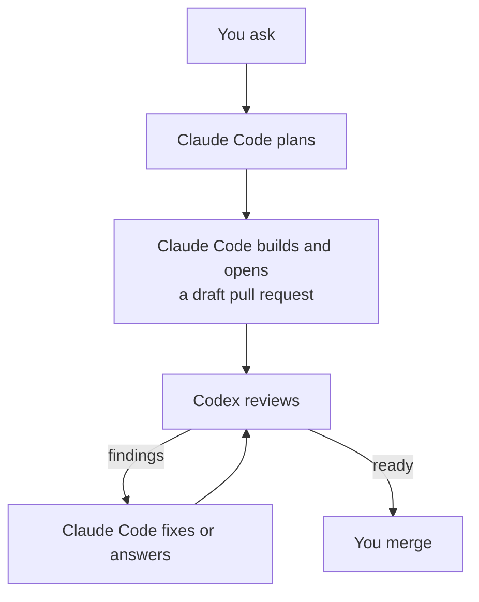

# How Mentat works

*For people. Agents follow `rules.md` and the skills in `skills/`, not this page.*

## How a change moves, in full

From a request to a merge; the numbered steps below describe each part.

1. Work starts from a chat request or an issue. Claude Code reads the repository's AGENTS.md files and the code, then writes down what it will build and how it will be checked. An uncertain or consequential plan gets a Codex challenge first ([`skills/plan`](../skills/plan/SKILL.md)).
2. One builder, one branch, one checkout per change. The builder is a subagent, so its edits stay out of your chat: the main session plans, briefs and reports. The repository's test command runs before the pull request opens and after every fix.
3. Every pull request opens as a draft, with a description that gives a short summary, before-and-after evidence and the merge danger ([`skills/pr`](../skills/pr/SKILL.md)).
4. When it is built, `mentat review` waits for CI on the head, then Codex reviews it, through OpenAI's Codex GitHub app or local Codex. Claude Code fixes findings that have a realistic trigger, answers the rest with a reason, and reviews again; a real defect is never left to a follow-up issue on its own, and five rounds is a hard stop. OpenAI's page says the Codex app flags only P0 and P1 issues (it has posted P2s here); a local review reports P0 to P3 and reads the issues the pull request closes as well as its description. When the loop ends ready, it posts a final check, the author's own check and not an approval, and tells you the pull request is ready. If the loop is blocked, not reviewed, or reaches five rounds without being ready, it tells you why and stops ([`skills/review`](../skills/review/SKILL.md)).
5. You merge it, the way your repository merges. Or opt the repository in, and Claude Code merges its own pull requests once the review loop ends ready ([Letting agents merge](setup.md#letting-agents-merge)).

After a session that went badly, `/mentat:retro` reads it and proposes fixes to the setup: checks over written rules, pointers, deletions. It changes nothing until you approve; approved fixes become issues or pull requests ([`skills/retro`](../skills/retro/SKILL.md)).

When a message loses you, run `/mentat:come-again`: Claude Code says its last message again in at most three short lines, or the part you typed after the command, and changes nothing ([`skills/come-again`](../skills/come-again/SKILL.md)).

To skip Codex for a session, run `/mentat:codex-review-off`. Claude Code then runs one Claude `code-review`, asked for at medium effort, per pull request (at most two rounds) instead of the Codex review, and no plan challenges: it still runs the tests, waits for CI and posts its final check marked reviewed by Claude, not Codex, then tells you the pull request is ready, and never merges it itself, even in a repository opted in to agent merges; you still merge. If `code-review` cannot run, the final check says "Not reviewed" and why. The limit: the reviewer is the same model family as the builder, so it is weaker than a cross-model review. OpenAI's Codex GitHub app, if installed with automatic reviews, can still review when the pull request is marked ready; that is the app's setting. Run `/mentat:codex-review-on`, or say so in chat, to turn Codex back on ([`skills/codex-review-off`](../skills/codex-review-off/SKILL.md), [`skills/codex-review-on`](../skills/codex-review-on/SKILL.md)).

## The repository comes first

Mentat requires nothing of a repository's GitHub settings. Rulesets, required approvals, merge methods and CI are yours, and Mentat works within whatever you have. Where your AGENTS.md says something different from Mentat's rules on a preference, such as commit format, branch flow, or a workflow that commits to the default branch, your AGENTS.md wins.

If your repository requires an approval and the agent opens pull requests as you, GitHub will not let you approve your own pull request. Use a separate GitHub account for the agent in that case; Claude Code tells you when it happens.

## What holds, and how

### Claude Code hooks

- The SessionStart hook puts `rules.md` into every session's context, on startup, resume, clear, compact and fork.
- The merge hook asks you in a permission prompt before any `gh pr merge` command (including `--auto`), any call to the pull request merge API through `gh api`, and the desktop app's auto-merge tool. One exception, in a repository that opted in: a single merge API call through `gh api`, pinned to a commit with `sha=`, for a pull request opened by the account `gh` is signed in as, goes through Claude Code's normal permission rules without Mentat's prompt. The hook reads the opt-in from the repository's AGENTS.md on its default branch on GitHub each time, and `gh pr merge` always asks. Claude Code's docs say a hook's "ask" still prompts in auto mode; behavior in bypass-permissions mode is not documented. It is a net for mistakes, not a security boundary: other routes to a merge exist.
- The Mentat pane and its footer label (desktop app and terminal) show what needs you and what is going on. How they work, and how to remove them, is in [pane/README.md](../pane/README.md).
- The `mentat` command is available to Claude Code's Bash tool while the plugin is on. It is not on your own terminal's PATH; Claude Code runs it.

### Instructions, not guarantees

`rules.md` asks agents never to merge (unless you opted the repository in), release, deploy, publish, change secrets or run production operations; never to commit secrets; never to push code changes to the default branch or change repository settings; and to keep production credentials out of agent sessions. An agent that ignores its instructions can still do what its GitHub access and your Mac allow. Mentat does not sandbox it; Claude Code's permission modes are the local control. To have GitHub enforce rules, see [Have GitHub enforce it](setup.md#have-github-enforce-it).

They draw on:

- [Anthropic's Claude Code best practices](https://code.claude.com/docs/en/best-practices): give the agent a check it can run, plan when the approach is uncertain, the change touches several files or the code is unfamiliar, and skip the plan for a small clear change, keep instruction files short, and use an independent reviewer told to flag only what affects correctness or the stated requirements, because chasing every finding leads to over-engineering.
- [OWASP's AI Agent Security Cheat Sheet](https://cheatsheetseries.owasp.org/cheatsheets/AI_Agent_Security_Cheat_Sheet.html): least privilege for agent tools, human approval for high-impact or irreversible actions, and minimal sensitive data in agent context.
- [When Does a Second Model Help? Cross-Model Review in LLM Verification](https://arxiv.org/html/2610.01471) (Song, 2026): different models catch partly different errors, though capability differences make the benefit of diversity alone hard to isolate.

### Mentat's own choices

These are design choices, not proven results:

- You merge, by default. Agents plan, build and answer reviews; letting them merge is your choice, one repository at a time.
- A different model family reviews the builder's work: Codex reviews what Claude Code builds.
- Reviews come from OpenAI's Codex GitHub app when it is set up, which posts under its own identity with comments on specific lines. It was chosen over a local review after a five-pull-request comparison ([issue 3](https://github.com/ericfurspan/mentat/issues/3)). The local review is the fallback and is labeled as one.
- Review findings are fixed only when they have a realistic trigger; gates stay small.
- macOS only, with scripts in plain bash that also runs on macOS's bash 3.2.

## Commands

| Command | What it does | Exit codes |
|---|---|---|
| `mentat review <PR>` | Waits for CI on the pull request's head (up to 30 minutes; with no CI, about a minute), then marks the pull request ready, which starts the Codex app's review of that head, and waits up to 20 minutes for the result. A pull request already marked ready goes back to draft for a moment, then ready again, to start the review. With no result in time, the review is "not reviewed" and Claude Code falls back to `--local` | 0 no findings, 2 findings posted (links printed), 1 not reviewed, 3 head moved, 4 CI did not pass (failing or unfinished checks printed) |
| `mentat ci <PR>` | Waits for CI on the pull request's head the same way, and reviews nothing. Used by `/mentat:codex-review-off` | 0 CI passed or there is none, 1 could not read, 3 head moved, 4 CI did not pass (failing or unfinished checks printed) |
| `mentat review --local <PR>` | Waits for CI the same way, then reviews the pull request's head with local Codex in a temporary checkout, and posts the result on the pull request if the head has not moved | same |
| `mentat challenge <plan-file>` | Codex challenges a written plan against the repository and ends with a verdict | 0 delivered (read the verdict), 1 not challenged |
| `mentat check` | Checks, read-only, what Mentat itself needs: `git`, `gh` and `jq` installed, `gh` signed in, the repository readable. Prints the installed `codex` version. Warns when `codex` is missing or the repository has Actions secrets a branch workflow may read | 0 Mentat can work, 1 it cannot |

Local Codex (`review --local` and `challenge`) runs under a permissions profile that lets it read only the checkout, its git directory and system and tool paths, with no writes and no network for the commands it runs. Codex itself still talks to OpenAI, and its web search runs on OpenAI's side, outside that profile: local reviews turn search off, and `mentat challenge` keeps Codex's cached search (OpenAI's index, no live fetches) to check current practice. Inside the checkout, files that commonly hold credentials (`.env` files, private keys such as `*.pem` and `id_ed25519`, `.netrc`, `.npmrc`, `.pypirc`) are denied to it as well. This protects files kept out of git; a credential committed to the repository stays readable through git history, as it is to anyone with the repository, and must be rotated. Only basic environment variables (such as `HOME`, `PATH` and `USER`) reach the commands it runs. Where Codex must be installed is under [What you need](setup.md#what-you-need).

## What it does not do

- Linux, Windows, other Git hosts, organizations and team workflows.
- Running deployments or infrastructure.
- Changing your repository's GitHub settings. `mentat check` reads none of them beyond whether the repository has Actions secrets. At the final check, Claude Code reads whether the repository requires approvals; when it merges in a repository you opted in, it also reads which merge methods the repository allows.

## Developing Mentat

`tests/run` is the one test command; it runs locally on macOS, and this repository has no CI. The maintainer merges every change; this repository is not opted in to agent merging.
