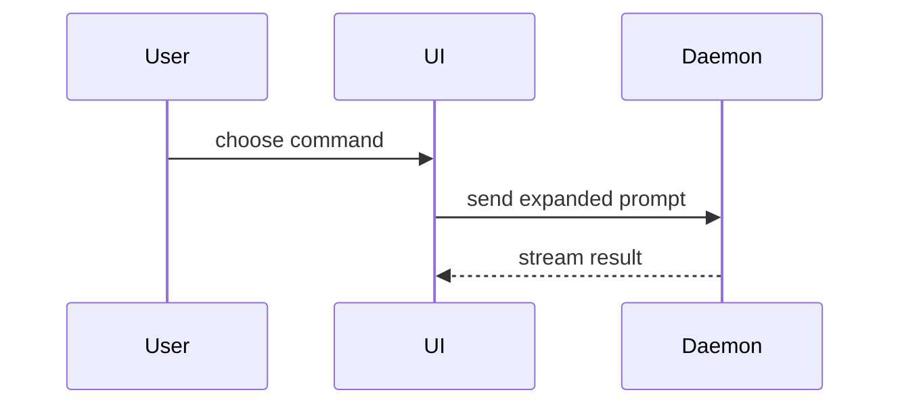

# Visuals for a pull request summary

Pick the smallest view that makes the key point clear. Place each one next to the short sentence it supports, and keep only the calls, files, states and boundaries the point needs. One is usually enough; several is rare.

- **Pseudocode** for logic or an algorithm:

```text
on(save)
  if content is unchanged
    return cached result
  write new content
  return fresh result
```

- **Call tree** for runtime control flow:

```text
submitForm
  createSession
    persistPrompt
    launchAgent
  navigateToSession
```

- **Component tree** for UI structure, with the state and module boundaries that matter:

```text
<SessionPage> (apps/example/src/routes/session.tsx)
  useSessionEvents()
  <SessionToolbar>
    <RunSkillButton> (packages/ui)
```

- **File tree** for file responsibility or a broad refactor:

```text
src/
├── commands/       # parses user actions
├── sessions/       # owns session state
└── transport/      # sends API requests
```

- **Mermaid** for interaction or data flow between parts:



- **Shaped diff** when the point is what changes and the surrounding shape already exists. Match the diff's shape to the topic: a tree, a call stack, or control flow.

```diff
 submitForm
   createSession
     persistPrompt
+    expandSkillMention
     launchAgent
```

- **The whole block** when most of it is new, or when leaving out context would hide ownership or order.
