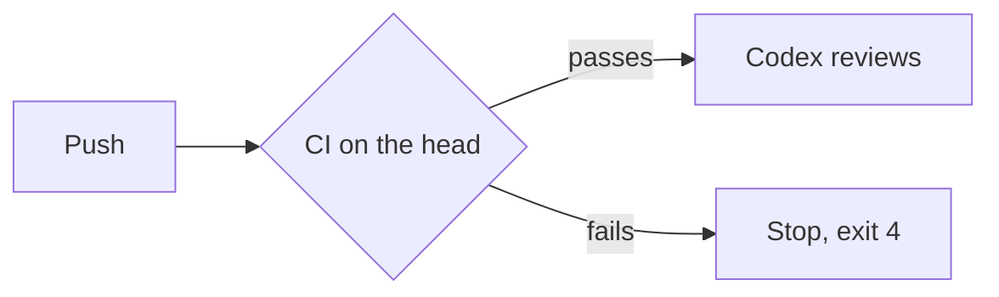

# Visuals for a pull request summary

Use a visual only when it makes the point faster than prose. Give it a one-line lead-in that says what it shows, place it next to the sentence it supports, and keep only what the point needs. One is usually enough.

Pick by what the point is, in this order:

1. **What happens in each case** (inputs, states, outcomes, a before and after per item): a **table**.

What `mentat review` does with each CI result on the head commit:

| CI on the head | `mentat review` |
|---|---|
| All checks pass | Reviews as before |
| A check fails | Stops, exit 4, lists the failing checks |
| No checks after 60 s | Treats the repository as having no CI, reviews |

2. **An order of steps, or who calls whom**: a **Mermaid** flowchart or sequence diagram. GitHub renders it as a diagram.

How a review starts after this change:



3. **Where files or responsibilities live, or what moved**: a **file tree** or a **shaped diff** of the tree.

Where the review loop lives after this change:

```diff
 rules.md            # always loaded; one pointer per step
 skills/
   pr/SKILL.md
+  review/SKILL.md   # review loop and final check
```

4. **Code structure**: a **call tree** or **component tree**, with only the calls or components that changed and their neighbors.

```text
submitForm
  createSession
    persistPrompt
    launchAgent
```

5. **The logic of one function**: **pseudocode**. Use it only for code logic, never to describe behavior or outcomes; a table does that better.

```text
on(save)
  if content is unchanged
    return cached result
  write new content
```

6. **The whole block**, when most of it is new, or when leaving out context would hide ownership or order.
